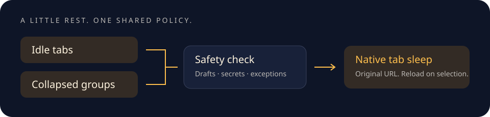

<p align="center"></p>
<h1 align="center">TabSiesta</h1>
<p align="center"><strong>Let your tabs rest. Keep your work awake.</strong></p>
<p align="center">Native tab sleep for Chrome, with idle timers, collapsed-group automation,<br />and protection for drafts and one-time secrets.</p>
<p align="center"><a href="LICENSE">MIT licensed</a> · <a href="docs/guide.md">User guide</a> · <a href="CONTRIBUTING.md">Contribute</a></p>



TabSiesta uses Chrome’s native `tabs.discard()` API. Tabs keep their original URLs,
icons, and place in your window. Select a sleeping tab to reload it.

**Status: 0.1.0 preview.** Automated policy and UI tests pass. Real-Chrome end-to-end
verification is still outstanding; see [verification notes](docs/verification.md).

## Why TabSiesta?

| Feature | What it does |
| --- | --- |
| **Sleep idle tabs** | Check every minute, with a default idle threshold of 10 minutes. |
| **Sleep collapsed groups** | Evaluate a group as soon as you collapse it. |
| **Protect your work** | Keep selected tabs, edited forms, and unchecked pages awake. Audio and pinned exceptions are enabled by default. |
| **Protect one-time secrets** | Recognize customizable warning phrases, including recovery codes, seed phrases, and private keys. |
| **Make it yours** | Set site exceptions, protect individual tabs, and edit recommended phrases. Updates preserve your choices. |
| **Stay lightweight** | A stats-only popup, full-tab settings, and no placeholder pages or remote services. |
| **Audit your tabs** | Filter sleeping and awake tabs in a full-page view, with protection and recorded sleep reasons. |

Automatic and audit sleep actions use the same safety policy. If a page’s safety cannot be
checked, TabSiesta leaves it awake. Its rules do not control Chrome Memory Saver
or other extensions.

## Chrome Web Store

**Coming soon.** Use the development installation below to try TabSiesta today.

## Install (development)

You need **Chrome 121+**, **Node.js 22.12+**, and **pnpm 10**.

```sh
git clone https://github.com/ak5/tabsiesta.git
cd tabsiesta
pnpm install --frozen-lockfile
pnpm build
```

1. Open `chrome://extensions/` in Chrome.
2. Enable **Developer mode**.
3. Choose **Load unpacked**, then select `.output/chrome-mv3` inside your clone.
4. Pin TabSiesta. Open the popup for counts, **Options** for settings, or **Tab Audit**
   to inspect and manage tabs.

On macOS, press **⌘⇧.** in the folder picker to show the hidden `.output` folder.

After a source change, rebuild and click **Reload** at `chrome://extensions/`.
Use `pnpm zip` to create a distribution archive in `.output/`.

## Privacy and safety

Everything runs locally. There is **no telemetry, browsing-history collection,
remote code, or external font loading**. Settings stay on your device.

Site access lets the page guard inspect forms and visible warning phrases. It
sends safety booleans and configured phrase IDs; it never stores or transmits form values, page text, or
secrets. The [permissions table](docs/guide.md#permissions-and-privacy) explains
each requested permission.

Detection is conservative, but it cannot identify every unsaved application state.
Use **Keep this tab awake** or a site exception for important pages. Read the
[detection boundaries](docs/guide.md#detection-boundaries) before relying on
automatic sleep for sensitive work.

## Development

Built with **WXT · Svelte 5 · TypeScript · Tailwind CSS 4**.
The service worker and page guard do not load the UI framework.

```sh
pnpm check       # TypeScript and Svelte
pnpm lint        # ESLint
pnpm test        # Policy, guard, worker, and UI tests
pnpm build       # Production Chrome extension
pnpm dev         # Development build on an available local port
```

For isolated Chrome integration tests:

```sh
pnpm exec playwright install chromium
pnpm test:e2e
```

Tests use a temporary profile and fixture pages, never your signed-in browser.

```text
src/entrypoints/   Background worker, page guard, popup, options, and tab audit
src/lib/           Shared policy, settings, session state, and discard engine
tests/             Unit and UI tests
e2e/               Real-Chrome integration tests
public/            Icons and bundled license notices
docs/              User guide, architecture references, and verification
```

## Contributing

Bug reports, focused fixes, and improvements to safety detection are welcome.
Start with [CONTRIBUTING.md](CONTRIBUTING.md). Report security issues according to
[SECURITY.md](SECURITY.md), and use synthetic examples rather than real secrets.

See the [documentation index](docs/index.md) for detailed behavior and repository
conventions.

## Acknowledgments and license

Architectural references:

- [Tab Group Auto-Sleep](https://github.com/dragonish/Tab-Group-Auto-Sleep)
- [Tab Suspender](https://github.com/theluckystrike/tab-suspender-chrome-extension)

TabSiesta contains original application code and assets. See the
[upstream design notes](docs/upstream-design.md) for what we learned and how the
implementation differs.

Released under the [MIT license](LICENSE). Bundled dependency notices are in
[THIRD_PARTY_NOTICES.txt](public/THIRD_PARTY_NOTICES.txt).
